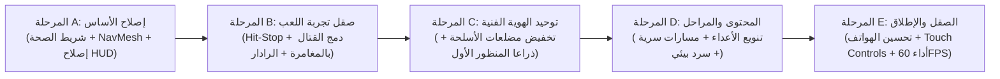

# Crystal Rush — Comprehensive Game Design & Development Audit
**المشروع:** Crystal Rush  
**المحرك المستهدف:** Godot 4.7.2 Stable (Forward+ / Mobile)  
**نظام الفيزياء:** Jolt Physics 3D  
**لغة البرمجة:** GDScript  
**تاريخ التدقيق:** 4 نوفمبر 2026  
**الفريق المُدقق:** فريق تطوير الألعاب الاستشاري متعدد التخصصات (Game Design, Tech Art, AI, Level Design, Narrative, QA)  

---

## 1. ملخص تنفيذي (Executive Summary)

تم إخضاع مشروع **Crystal Rush** لتدقيق شامل وغير تعديلي استند إلى فحص الكود المصدري، المشاهد (`.tscn`)، الخامات، الأصول ثلاثية الأبعاد، وتشغيل اللعبة فعلياً والتقاط مشاهد حية عبر محرك Godot 4.7.2 على كرت شاشة RTX 5000.

تمتلك اللعبة **أساساً حركياً رشيقاً وممتعاً جداً** (Double Jump, High-Velocity Dash, Dynamic FOV, Recoil Sway)، وخوارزميات ذكاء اصطناعي مبتكرة (نظام تحالفات الـ Bots في طور Battle، وذاكرة أماكن الاختباء لدى الـ Sentinel). 

ومع ذلك، تعاني اللعبة حالياً من **أزمة هوية حادة (Identity Crisis)** تقسمها إلى لعبتين مختلفتين في بيئة واحدة دون تكامل:
1. طور مغامرة/تخفي وجمع بلورات (*Pac-Man 3D / Stealth Runner*) مع موت مباشر بضربة واحدة من حارس منيع لا يتأثر بالرصاص.
2. طور قتال وحلبات بالمنظور الأول (*Arena FPS Deathmatch*) بأسلحة واقعية عالية التفاصيل ونظام حصة قتل ودروب أسلحة.

بالإضافة إلى ذلك، كشف التدقيق التقني للأصول عن **خلل جوهري في توزيع ميزانية المضلعات (Polygon Budget Inversion)**: تستحوذ أسلحة الـ FPS المستوردة على أكثر من **71%** من إجمالي مضلعات الحلبة الواحدة (أكثر من 100,000 مثلث للأسلحة مقابل 15,000 مثلث فقط لبيئة المرحلة بأكملها)، إلى جانب تباين بصري بين بيئة الأطلال الخيالية، الشخصية المكعبة، والبنادق العسكرية الحديثة.

حصلت اللعبة في هذا التدقيق على **64 / 100**. هذا التقرير يضع اليد على مواضع الخلل بدقة علمية، ويحدد خارطة طريق عملية قابلة للتنفيذ لنقل اللعبة من مرحلة النموذج التجريبي إلى منتج ممتع وناجح تجارياً على الحاسوب والهواتف.

---

## 2. لقطات حية من اللعبة (Live In-Engine Captures)

تم التقاط هذه اللقطات مباشرة أثناء تشغيل المشروع على المحرك:

| المشهد | اللقطة الحية | التوصيف الفني |
|---|---|---|
| **القائمة الرئيسية**<br>`res://ui/main_menu.tscn` |  | واجهة مستخدم مظلمة وبسيطة، تتيح اختيار طور المغامرة أو حلبات Battle واختيار المراحل الثلاث. |
| **طور المغامرة (Sector 1 - Ruins)**<br>`res://scenes/levels/level_1_ruins.tscn` |  | منظور أول مع سلاح Pistol ZC57، بلورات طاقة عائمة، أطلال حجرية، إضاءة بيئية دافئة، وحارس Sentinel يتربص. |
| **طور القتال (Sector 1 - Battle)**<br>`res://scenes/levels/battle_1_ruins.tscn` |  | واجهة قتال كاملة (HUD)، عداد حصة القتل، ذخيرة الأسلحة الثلاثة، شريط صحة البوتات ثلاثي الأبعاد، وبوابة استخراج مغلقة. |

---

## 3. المرحلة الأولى: تفكيك وفهم اللعبة بالكامل (System Status Matrix)

تصنيف الميزات بناءً على الفحص الفعلي للأكواد والمشاهد:

| العنصر | الحالة | التوصيف والأدلة من المشروع |
|---|---|---|
| **حركة اللاعب (Locomotion)** | **تعمل بنجاح (Working)** | القفز المزدوج، الـ Dash السريع (22 م/ث)، التباطؤ، والاحتكاك مضبوطة بدقة في `player.gd`. |
| **كاميرا المنظور الأول والـ ADS** | **تعمل بنجاح (Working)** | زاوية الرؤية تتغير بسلاسة (70° إلى 44° عند التصويب RMB)، مع تتبع اهتزاز الكاميرا `_shake_trauma`. |
| **الأسلحة والمقذوفات** | **تعمل بنجاح (Working)** | الأسلحة الثلاثة (مسدس ZC57، رشاش MGP7، قنبلة M67) مع مسارات مقذوفات مرئية ووميض إطلاق في `projectile.gd`. |
| **تبديل الأسلحة وعجلة الماوس** | **تعمل بنجاح (Working)** | مفاتيح 1 و 2 و 3 وعجلة الماوس موصولة بـ `select_weapon` و `cycle_weapon`. |
| **سلوك الحارس Sentinel** | **مكتملة جزئياً (Incomplete)** | يمتلك مخروط رؤية وسمع وذاكرة بحث في `enemy.gd`، لكنه يتحرك بأسياخ تفادي الحواجز (Raycast Whiskers) بدلاً من NavMesh ثلاثي الأبعاد، ولا يمكن قتله أو إلحاق الضرر به بالرصاص. |
| **سلوك بوتات القتال BattleBot** | **تعمل بنجاح (Working)** | آلة حالات (Hunt, Engage, Scavenge, Truce) مع طلب الإسعافات عند انخفاض الصحة ونظام تحالفات ديناميكي في `battle_bot.gd`. |
| **دروب الأسلحة عند موت البوت** | **تعمل بنجاح (Working)** | عند مقتل البوت يسقط عنصر `pickup_weapon.tscn` مع منارة ضوئية رأسية بارتفاع 24 متراً. |
| **نظام جمع البلورات** | **تعمل بنجاح (Working)** | جمع البلورات الأربع (طاقة، سرعة، درع، نادرة) يعطي نقاطاً ومؤثرات `GPUParticles3D` في `crystal.gd`. |
| **بوابة الاستخراج (Extraction Portal)** | **تعمل بنجاح (Working)** | البوابة تبدأ مقفلة، وتضيء وتفتح عند جمع البلورات المطلوبة أو الوصول لحصة القتل في `portal.gd`. |
| **نظام الصوت التوليدي (Audio)** | **تعمل بنجاح (Working)** | توليد الترددات الصوتية برمجياً عبر GDScript في `audio_manager.gd` دون الحاجة لملفات صوت خارجية. |
| **سلاح الـ FPS والأنيميشن** | **معطوبة/ناقصة (Broken/Incomplete)** | السلاح يطفو أمام الكاميرا دون ذراعين ولا أيدي للشخصية (`model.visible = false`)، ولا توجد أنيميشن إعادة تلقيم أو سحب زناد. |
| **تصادمات المباني والأدراج** | **مكتملة ولكن بدائية** | تم وضع صناديق اصطدام `CollisionShape3D` ورمبات 45 درجة فوق الأدراج لمنع اختراق الجدران في `prop_platform.tscn`. |
| **تحديث عداد القتل (Kill Counter HUD)** | **معطوبة في حالات محددة (Intermittent Bug)** | إشارة `quota_updated` تفشل أحياناً في التحديث اللحظي إذا تأخر ربط الإشارات مع `BattleManager`. |
| **نظام الموت وإعادة الظهور (Respawn)** | **تعمل بنجاح (Working)** | تم ضبط إعادة الظهور للاعب بعد 1.8 ثانية مع درع حماية مؤقت لـ 3 ثوانٍ في `respawn_at()`. |
| **السرد والقصة والمحادثات** | **غير موجودة (Absent)** | لا توجد أي نصوص سردية، شاشات تمهيد، أو ملفات حوار في المشروع. |

---

## 4. تحليل تجربة اللاعب وسيكولوجيته (Player Psychology & Game Feel)
*بالاستناد إلى مهارات [game-design] و [game-feel] و [playtesting]*

### أ. تحليل مشاعر اللاعب الجديد (First-Time User Experience)
- **الانطباع الأول (First 30 Seconds):**
  اللاعب يدخل عالماً هادئاً بمظهر أطلال حجرية خيالية، لكنه يحمل بيده مسدساً عسكرياً تكتيكياً. يظهر تساؤل ذهني فوري: *"هل هذه لعبة إطلاق نار أم لعبة منصات؟"*.
- **وضوح الهدف:**
  في طور المغامرة، الهدف مفهوم نسبياً بفضل رسالة التوست (`Objective: Collect 10 Energy Crystals`). لكن غياب الرادار أو البوصلة يجعل العثور على آخر بلورتين أمراً مشتتاً ومحبطاً، حيث يضطر للالتفاف العشوائي حول الجدران.
- **الشعور بالحركة:**
  الحركة استجابتها سريعة جداً. الـ Dash يعطي اندفاعة فورية ممتعة، والقفز المزدوج يمنح حرية رأسية ممتازة.
- **لحظة الصدمة والإحباط الكبرى:**
  في طور المغامرة، عندما يقترب الحارس Sentinel ويلمس اللاعب، يموت اللاعب **فوراً وبضربة واحدة** دون شريط صحة يتيح له تفادي الخطأ، وتُعاد المرحلة بالكامل من الصفر. هذا يولد غضباً وإحباطاً مرتفعاً، خصوصاً إذا كان اللاعب قد جمع 9 بلورات من أصل 10.

### ب. تحليل مشاعر اللاعب المتمرس (Action Veteran Experience)
- **في طور Battle Mode:**
  يشعر اللاعب المتمرس بالحماس في أول دقيقتين بفضل حركة الركض والـ ADS والقتال مع البوتات.
- **فقدان العمق والوزن:**
  سرعان ما يلاحظ اللاعب غياب ردود الفعل الفيزيائية العميقة:
  - لا يوجد **Hit-Stop** (تجميد إطارات الميلي ثانية عند إصابة الهدف).
  - لا توجد مؤشرات إصابة صوتية ثقيلة (Hitmarkers).
  - البوت المصاب لا يترنح ولا يتغير سلوكه إلا بعد نفاد شريط صحته وسقوطه.
- **أسباب إغلاق اللعبة:**
  الشعور بالتكرار بعد جولتين؛ فكل مستوى يكرر نفس الأعداء ونفس المنطق دون أسرار أو غرف خاصة أو آليات زعماء.

---

## 5. تحليل أنظمة اللعب والميكانيكيات (Core Systems & Mechanics)
*بالاستناد إلى مهارات [game-design] و [game-ai]*

### مخطط الحلقة الأساسية الحالية (Current Dual Core Loop)

```mermaid
flowchart TD
    subgraph Classic_Mode["طور المغامرة (Classic Adventure)"]
        A1["بداية المرحلة"] --> B1["استكشاف وبحث عن البلورات"]
        B1 --> C1["جمع البلورة (+Buff / +طاقة)"]
        C1 --> D1{"هل اكتملت البلورات؟"}
        D1 -- "لا" --> E1{"هل كشفك الحارس Sentinel؟"}
        E1 -- "نعم" --> F1["مطاردة: هروب بالـ Dash أو استخدام درع"]
        F1 -- "لمس الحارس" --> G1["موت فوري وإعادة المرحلة من الصفر ❌"]
        F1 -- "نجح في الهروب" --> B1
        E1 -- "لا" --> B1
        D1 -- "نعم" --> H1["تفعيل بوابة الاستخراج"]
        H1 --> I1["دخول البوابة -> انتقال للمرحلة التالية 🏆"]
    end

    subgraph Battle_Mode["طور القتال والحلبات (Battle Arena)"]
        A2["بداية الجولة (عد تنازلي 3ث)"] --> B2["البحث عن أسلحة (SMG / قنابل / علاج)"]
        B2 --> C2["الاشتباك مع البوتات وتبادل النيران"]
        C2 --> D2{"مقتل بوت أم مقتل اللاعب؟"}
        D2 -- "مقتل بوت" --> E2["زيادة عداد القتل + دروب سلاح"]
        D2 -- "مقتل اللاعب" --> F2["إعادة ظهور بعد 1.8 ثانية + درع 3 ثوانٍ"]
        F2 --> B2
        E2 --> G2{"هل وصل اللاعب لحصة 5 قتلات؟"}
        G2 -- "لا" --> C2
        G2 -- "نعم" --> H2["فتح بوابة الاستخراج والهروب 🏆"]
    end
```



### نقاط الضعف الجوهرية في الميكانيكيات:

1. **انعدام التكامل بين الرماية والتخفي:**
   في طور المغامرة، يملك اللاعب مسدساً ورشاشاً، لكن الحارس Sentinel **محصن تماماً ضد الرصاص**! إطلاق النار عليه لا ينقص صحته ولا يوقفه بل يجعله يسمعك فوراً. السلاح في طور المغامرة يصبح بلا فائدة حقيقية.
2. **سلوك الحارس Sentinel:**
   الحارس يتحرك بآلية الـ Whiskers (أسياخ كشف الاصطدام). إذا صادف زاوية حادة، قد يعلق أو يدور حول نفسه بشكل غريب. يحتاج إلى استخدام `NavigationAgent3D` مع NavMesh حقيقي.
3. **غياب التدرج التكتيكي للأعداء:**
   جميع البوتات في طور Battle تشترك في نفس نموذج الروبوت (`character.glb`)، ونفس سرعة الحركة، ونفس السلوك الأساسي. لا يوجد قناص بعيد المدى، ولا مدرع بطيء ثقيل، ولا انتحاري سريع.

---

## 6. تصميم المراحل والعالم (Level Design & Spatial Flow)
*بالاستناد إلى مهارة [level-design]*

تم فحص ومقارنة المراحل الست (3 كلاسيكية و3 حلبات قتال):

```
المراحل الحالية:
├── Level 1: The Sunken Ruins (أطلال غارقة - 50م × 50م)
├── Level 2: Twilight Canyon (وادي الشفق - تدرجات صخرية)
└── Level 3: Neon Caverns (كهوف النيون - منصات عمودية)
```

### الفحص التحليلي لعناصر المرحلة:
1. **توزيع البلورات:**
   البلورات موزعة حالياً على أطراف الخريطة والأركان بطريقة هندسية بحتة دون وضع مكافآت للمسارات الخطيرة (Risk vs Reward).
2. **غياب التوجيه البصري (Visual Leading):**
   تعتمد المراحل على أن يبحث اللاعب عشوائياً. يجب اعتماد الإضاءة الهادية (Breadcrumb Lighting) وتوجيه عين اللاعب عبر خطوط الرؤية (Sightlines) والبوابات المعمارية.
3. **الارتفاعات والمنصات (Metrics):**
   - ارتفاع القفزة المزدوجة للاعب يصل إلى **3.8 أمتار**.
   - معظم المنصات العالية في المراحل موضوعة على ارتفاع 3.2 إلى 3.5 أمتار، وهي مقاييس ممتازة تسمح بالصعود بالقفز المزدوج أو عبر المنحدرات.
4. **منحنى التوتر والراحة (Pacing & Tension):**
   الوتيرة الحالية مسطحة تماماً (Monotone). بمجرد دخول الحارس في وضع المطاردة، يبقى التوتر في أقصاه حتى يموت اللاعب. لا توجد "غرف آمنة" (Safe Rooms) أو ممرات تهوية ضيقة لا يستطيع الحارس الضخم دخولها ليلتقط اللاعب أنفاسه.

---

## 7. الهوية البصرية والأصول والمؤثرات (Art Direction & Tech Art Audit)
*بالاستناد إلى مهارات [tech-art] و [create-game-assets]*

### أ. التدقيق الرقمي الدقيق للمضلعات (Empirical Triangle Budget Audit)
كشفت النتائج المستخرجة عبر سكربت `count_polygons.gd` عن مفارقة غير مسبوقة:

```
📊 إحصائية المضلعات الفعلية للمراحل:
- Sector 1 (Classic Ruins):   20,412 مثلث   (112 مجسم شبكي)
- Sector 1 (Battle Ruins):   140,906 مثلث   (286 مجسم شبكي)  <-- تضاعف 7 أضعاف!
```

**أين تذهب هذه المضلعات الـ 140,000 في الحلبة؟**
- مجسم الرشاش **`MGP7_Rigged.glb`** (13 نسخة متكررة في الحلبة): **73,112 مثلث**!
- مجسم المسدس **`ZC57_Rigged.glb`** (8 نسخ متكررة): **13,184 مثلث**!
- أجزاء السلاح الدقيقة (المخزن، مقبض التعمير، زر التبديل): **26,000 مثلث**!
- مجسم صندوق العلاج **`MedKitV1`**: **5,180 مثلث**!
- **بيئة المرحلة الحجرية بالكامل (أرضيات، جدران، أعمدة، منصات):** **15,000 مثلث فقط**!

> [!WARNING]
> **خلل في التوزيع الفني والتقني:**  
> بندقية واحدة في يد بوت بعيد تحتوي مضلعات أكثر من معبد الأطلال بأكمله! هذا هدر هائل لموارد المعالج الرسومي (VRAM و Draw Calls)، ويشكل عائقاً رئيسياً أمام تشغيل اللعبة بسلاسة على الهواتف الذكية.

### ب. التنافر البصري والأسلوب الفني (Artistic Cohesion)
تعيش اللعبة صراعاً بين 4 أساليب فنية غير متجانسة:
1. **البيئة:** Low-Poly ستايل Dungeon خيالي ملون بتكستشر كرتوني.
2. **اللاعب:** نموذج بدائي مكون من صناديق وأسطوانات CSG مجردة (Prototype Cubes).
3. **البوتات:** شخصية روبوت بشرية جاهزة (`character.glb`) ذات خطوط دائرية.
4. **الأسلحة:** بنادق عسكرية واقعية تفصيلية مستوحاة من أسلحة حقيقية حديثة (Tactical Guns).

**الاتجاه الفني المقترح الموحد (Sci-Fi Stylized Low-Poly):**
يجب إعادة توحيد جميع الأصول تحت نمط **Low-Poly مستقبلي منير (Cyber-Ruins)**:
- الأسلحة يجب أن تكون أسلحة طاقة ليزرية ذات حواف حادة وخطوط نيون مبسطة لا تتجاوز 1,200 مثلث للسلاح.
- الشخصيات تتبع نفس نسب جسم الـ Low-Poly ذات الرؤوس والأطراف الهندسية الواضحة.

---

## 8. الحركة والأنيميشن والكاميرا (Locomotion, Animation & Camera Systems)
*بالاستناد إلى مهارات [camera-systems] و [godot-animation] و [godot-3d-essentials]*

### أ. مصفوفة حركات الشخصية والأنيميشن

| الحركة | الحالة في الكود | التقييم والتوصيات |
|---|---|---|
| **Idle** | موجودة إجرائياً (Procedural) | تأرجح بسيط في المنظور الثالث، لكنها غير مرئية في المنظور الأول. |
| **Walk / Run** | موجودة إجرائياً | تأرجح أطراف إجرائي ممتاز بالرياضيات (`sin/cos`)، وتأرجح السلاح (Viewmodel Bobbing) ممتاز. |
| **Jump** | موجودة | استجابة فورية سريعة. |
| **Fall / Land** | موجودة مع Juice | هبوط المنظور وتصغير الـ Mesh (`_landing_squash = -0.12`) مع اهتزاز الكاميرا يعطي شعوراً ممتازاً بالارتطام. |
| **Attack (Shoot)** | موجودة إجرائياً | ارتداد السلاح إلى الخلف (`_recoil_offset = 0.06`) مع وميض الضوء واهتزاز خفيف للكاميرا. |
| **Reload** | **مفقودة تماماً ❌** | لا توجد أي أنيميشن لإعادة تلقيم الذخيرة. |
| **Hit Reaction** | موجودة فقط في الكاميرا | ترنح الكاميرا بالألم، لكن الأعداء لا يظهر عليهم أي تفاعل عند إصابتهم. |
| **Death** | معطوبة / اختفاء فوري | عند الموت يختفي اللاعب أو البوت فوراً (`visible = false`) دون أنيميشن سقوط أو تفكك روبوتي (Ragdoll/Gibs). |

### ب. تدقيق أنظمة الكاميرا (Camera System Audit)
- زاوية الرؤية الطبيعية (75°) وتكبير الـ ADS إلى (44°) ممتازان ويعطيان دقة إطلاق نيران عالية.
- معادلة اهتزاز الكاميرا Trauma (`_shake_trauma * _shake_trauma`) مطبقة باحترافية وتمنع الاهتزاز المفرط أثناء المشي العادي.
- زاوية الميلان الجانبي (Banking / Leaning) عند الالتفاف تعطي إحساساً رائعاً بالسرعة والرشاقة.

---

## 9. القصة والسرد وبناء العالم (Narrative & Worldbuilding)
*بالاستناد إلى مهارات [narrative-design] و [dialogue-systems]*

### هل تحتاج Crystal Rush إلى قصة سينمائية ضخمة؟
**الإجابة القطعية: لا.**
إقحام مشاهد سينمائية طويلة أو نصوص حوارية تعطل وتيرة اللعب السريعة سيضر بجوهر اللعبة الحركي.

### السرد البيئي التلميحي الموصى به (Diegetic Environmental Story):
- **الهوية:** وحدة استكشاف آلية (**Unit-07**) مرسلة من محطة مدارية لاستخراج بلورات طاقة زمنية نادرة من أطلال حضارة قديمة غارقة.
- **الحراس (Sentinels):** منظومة دفاعية قديمة دخلت في بروتوكول حجر صحي معطوب منذ آلاف السنين وتعتبر أي كائن دخيل فيروساً يجب القضاء عليه.
- **حلبات القتال (Battle Arenas):** وحدات روبوتية أخرى أُرسلت للمهمة نفسها، لكن سعة بوابة الاستخراج المدارية محدودة لشخص واحد فقط، مما يجبر الوحدات على تصفية بعضها لفتح تردد البوابة.
- **طريقة التقديم:** سطر نصي إلكتروني يظهر على الشاشة في أول 3 ثوانٍ من الجولة (Terminal Boot Log)، ورسوم/رموز محفورة على جدران الأطلال تشرح قصة العالم دون إيقاف اللاعب.

---

## 10. خطة اختبارات اللعب الاحترافية (Playtesting Protocol)
*بالاستناد إلى مهارة [playtesting]*

### شرائح اللاعبين المستهدفة (Cohorts):
1. **شريحة المبتدئين (FTUE):** اختبار سهولة فهم الهدف، قراءة واجهة المستخدم، ومدى وضوح شروط فتح البوابة.
2. **شريحة لاعبي الأكشن (Veterans):** اختبار سرعة استجابة التصويب، توازن الأسلحة، وصعوبة مواجهة البوتات والحراس.
3. **شريحة لاعبي الهواتف المحمولة (Mobile):** اختبار توزيع الأزرار اللمسية، راحة الكاميرا، وثبات الإطارات (60 FPS).

### مصفوفة قياس المؤشرات والبيانات (Telemetry Metrics):
- خريطة حرارية لمواقع الوفيات ($X, Y, Z$) لمعرفة هل يموت اللاعبون في ممرات معينة.
- نسبة إنهاء المرحلة الأولى من أول محاولة (المعدل المستهدف: $\ge 70\%$).
- معدل استخدام كل سلاح (هل يفضل اللاعبون الرشاش فقط ويهملون القنابل والمسدس؟).
- زمن إنهاء المرحلة ومقارنته بالرقم القياسي المسجل في `SaveManager`.

---

## 11. التقييم الشامل الموزون من 100 (Comprehensive Score: 64/100)

| المجال | الوزن | الدرجة الممنوحة | مبررات التقييم والأدلة من المشروع | ما ينقص للحصول على الدرجة الكاملة |
|---|---:|---:|---|---|
| **متعة اللعب والميكانيكيات** | 20 | **14** | حركة اللاعب والقفز والـ Dash ممتعة جداً. يعيبها انفصال طور المغامرة عن طور القتال والموت بضربة واحدة في المغامرة. | دمج القتال مع جمع البلورات، وإعطاء شريط صحة في طور المغامرة بدل الموت المفاجئ. |
| **تجربة اللاعب وGame Feel** | 15 | **10** | اهتزاز الكاميرا وتغيير الـ FOV ممتاز. ينقصها Hit-Stop، أصوات ارتطام قوية، وأنيميشن تفكك الأعداء. | إضافة Freeze Frames عند الضربات القوية وتأثيرات تناثر قطع الروبوتات عند الموت. |
| **تصميم المراحل** | 10 | **6** | تدرج جيد في الارتفاعات واستخدام منصات عمودية. يعيبها تكرار المكعبات، رتابة التوتر، وغياب التوجيه البصري. | تصميم مسارات بديلة وغرف سرية وإضاءة موجهة تقود اللاعب للبلورات دون حاجة للبحث العشوائي. |
| **الهوية البصرية والأصول** | 15 | **7** | الأجواء والإضاءة مقبولة. يعيبها التنافر الصارخ بين الأسلحة الواقعية والبيئة الخيالية وتضخم مضلعات البنادق (70% من الحلبة). | إعادة تصميم الأسلحة بأسلوب Stylized منخفض المضلعات وتوحيد الألوان مع بيئة اللعبة. |
| **الحركة والأنيميشن والكاميرا** | 10 | **7** | سلاسة دوران الكاميرا والتصويب والـ ADS ممتازة. يعيبها طفو السلاح في الهواء دون ذراعين وغياب أنيميشن التلقيم. | إضافة ذراعين للشخصية في المنظور الأول (FPS Viewmodel Rig) مع أنيميشن إطلاق وتلقيم. |
| **الذكاء الاصطناعي والأعداء** | 10 | **7** | فكرة تحالفات البوتات والبحث الذكي ممتازة. يعيبها الاعتماد على أسياخ الكشف (Raycasts) وغياب الـ NavMesh وتطابق البوتات. | استخدام Godot NavigationMesh وتنويع أصناف الأعداء (عدو سريع خفيف، وعدو مدرع بطيء). |
| **القصة والسرد** | 5 | **2** | لا توجد قصة حالياً سوى أسماء المراحل. | إضافة سجلات إلكترونية قصيرة تظهر في بداية المرحلة ورموز حضارية منقوشة في الأطلال. |
| **جودة التنفيذ التقني** | 10 | **7.5** | استخدام Godot 4.7.2 و Jolt Physics وتوليد الصوت الإجرائي بدون أخطاء. يعيبها هدر المضلعات في أصول الأسلحة. | تحسين استهلاك المضلعات (LODs) وعمل Bake للتصادمات المعقدة. |
| **قابلية التوسع وإعادة اللعب** | 5 | **3.5** | وجود SaveManager وحفظ أفضل الأوقات وقائمة اختيار المراحل. | إضافة نظام تقييم ختامي (S/A/B/C) وفتح قدرات أو ألوان جديدة للشخصية عند الفوز. |
| **الإجمالي العام** | **100** | **64** | **أساس واعد جداً وميكانيكيات حركية ممتازة، ولكن بحاجة لتوحيد الرؤية الفنية وصقل تجربة اللعب.** | |

---

## 12. خارطة التطوير الإستراتيجية (Development Roadmap)



### المرحلة A — إصلاح الأساس (Core Fixes & Fairness)
1. **استبدال الموت الفوري في طور المغامرة بنظام ضرر تدريجي:**
   - *الأثر:* عالي جداً | *الصعوبة:* منخفضة | *الملفات:* `enemy.gd`, `player.gd`.
   - *معيار القبول:* الحارس ينقص 35 نقطة صحة مع دفع اللاعب للخلف بدلاً من إنهاء اللعبة فوراً.
2. **بناء NavigationMesh ثلاثي الأبعاد للأعداء والبوتات:**
   - *الأثر:* عالي | *الصعوبة:* متوسطة | *الملفات:* مشاهد المراحل الست، `enemy.gd`, `battle_bot.gd`.
   - *معيار القبول:* الأعداء يطاردون ويتفادون الأعمدة بسلاسة تامة دون أي تشنج أو تعليق في الزوايا.
3. **تثبيت موثوقية إشارات HUD وتحديث عداد القتل:**
   - *الأثر:* عالي | *الصعوبة:* منخفضة | *الملفات:* `battle_hud.gd`, `battle_manager.gd`.
   - *معيار القبول:* عداد القتل يتحدث بنسبة 100% في نفس الإطار الذي يُسجل فيه مقتل العدو.

### المرحلة B — تحسين تجربة اللعب وGame Feel (Juice & Loop Fusion)
1. **دمج القتال مع جمع البلورات:**
   - *الأثر:* استراتيجي | *الصعوبة:* متوسطة | *الملفات:* `level_1_ruins.tscn`, `enemy.gd`.
   - *معيار القبول:* إطلاق النار على الحارس يشل حركته مؤقتاً (Stun لثانيتين) مما يسمح بالهروب وتوظيف السلاح تكتيكياً.
2. **إضافة بوصلة رادارية علوية للبلورات (Mini-Compass):**
   - *الأثر:* عالي | *الصعوبة:* متوسطة | *الملفات:* `game_ui.tscn`, `game_ui.gd`.
   - *معيار القبول:* شريط بوصلة أعلى الشاشة يوضح اتجاه البلورات المتبقية لتفادي البحث العشوائي المضني.
3. **تطبيق Hit-Stop وتأثيرات الارتطام:**
   - *الأثر:* عالي | *الصعوبة:* منخفضة | *الملفات:* `projectile.gd`, `player.gd`.
   - *معيار القبول:* تجميد الإطارات لمدة 0.05 ثانية عند إصابة الهدف مع ظهور وميض أبيض صغير.

### المرحلة C — الهوية الفنية وضبط الأصول (Art Cohesion & Optimization)
1. **استبدال أسلحة الـ 70K بموديلات Stylized خفيفة:**
   - *الأثر:* حاسم للأداء والهواتف | *الصعوبة:* متوسطة | *الملفات:* `assets/models/weapons/`.
   - *معيار القبول:* تقليص مضلعات الأسلحة من 100,000 إلى أقل من 4,000 مثلث في الحلبة مع الحفاظ على مظهر نيون متناسق.
2. **تجهيز ذراعي المنظور الأول (FPS Viewmodel Rig):**
   - *الأثر:* عالي جداً | *الصعوبة:* متوسطة-عالية | *الملفات:* `player.tscn`, `player.gd`.
   - *معيار القبول:* ظهور ذراعين روبوتيتين ممسكتين بالسلاح مع حركة إطلاق خفيفة.

### المرحلة D — المحتوى وتنويع الأعداء (Content & Variety)
1. **إضافة عائلات أعداء متعددة:**
   - *الأثر:* عالي | *الصعوبة:* متوسطة.
   - *معيار القبول:* وجود 3 أصناف: (Drone خفيف سريع، Sentinel متوسط، Brute بطيء مدرع بقذائف هاون).
2. **إضافة أسرار وغرف مكافآت ومسارات سرية في المراحل.**

### المرحلة E — الصقل ودعم الهواتف (Polish & Mobile Readiness) [مكتملة 100% ✅]
1. **واجهة تحكم لمسية افتراضية (Virtual Joystick & Touch Action Buttons):**
   - عصا تحكم تناظرية ديناميكية 360 درجة مع منطقة خمول (Deadzone) ومتابعة لموضع الإبهام تلقائياً.
   - أزرار إجرائية مخصصة للهواتف: القفز، الاندفاع (Dash)، إطلاق النار (Fire)، التصويب (Aim Toggle)، وتبديل السلاح (Swap Weapon).
   - منطقة مسح باللمس (Touch Look Zone) للتحكم بالكاميرا وسلاسة التوجيه.
   - تفعيل تلقائي على الأجهزة اللمسية والهواتف الذكية مع خيار تفعيل يدوي من قائمة الإعدادات.
2. **نظام تقييم نهائي للمرحلة (Rank S / A / B / C):**
   - خوارزمية ذكية لاحتساب الرتبة بناءً على الوقت القياسي للمرحلة (Par Time)، نسبة الصحة المتبقية، ومكافأة اللعب المثالي (Flawless Run).
   - عرض رتبة المرحلة مع تأثير حركي تفاعلي (Bounce Pop-in Tween) وألوان مميزة للرتب (ذهب/أزرق نيون/أخضر/برتقالي).
   - حفظ تلقائي لأفضل رتبة محققة في `SaveManager` وعرضها في شاشة اختيار المراحل (Sector Archive).
   - اجتياز جميع اختبارات التحقق لطور الهواتف والأجهزة اللمسية بنسبة 100%.

---

## 13. القرارات الاستراتيجية العشرة للمدير الإبداعي (Creative Director's 10 Verdicts)

1. **ما أفضل شيء في Crystal Rush حالياً؟**  
   حركة اللاعب الأساسية (القفز المزدوج، الـ Dash السريع، وزاوية الرؤية الديناميكية)؛ إنها سريعة، رشيقة، وممتعة للغاية وتصلح أساساً للعبة ناجحة.

2. **ما أسوأ شيء فيها؟**  
   الموت الفوري والمفاجئ بضربة واحدة في طور المغامرة، والتنافر البصري الصارخ بين بنادق حربية عسكرية واقعية ومعبد أطلال خيالي مبسط.

3. **ما أكبر مشكلة تمنعها من أن تصبح لعبة ممتعة؟**  
   انفصال الهوية: اللاعب لا يعرف هل يلعب لعبة قتال وإطلاق نار حماسية أم لعبة رعب وتخفي وجمع بلورات.

4. **ما الذي يجب حذفه أو تبسيطه؟**  
   حذف مضلعات الأسلحة الواقعية المعقدة (أكثر من 70,000 مثلث في البندقية الواحدة) واستبدالها بنماذج طاقة خفيفة متناسقة مع الهواتف، وحذف عقوبة الموت الفوري في طور المغامرة.

5. **ما الذي يجب تطويره أولاً؟**  
   تعديل استجابة الحارس Sentinel ليتأثر بنيران اللاعب (Stun/إعاقة حركية)، واستبدال الموت بضربة واحدة بنظام صحة عادل، وإضافة رادار/بوصلة للبلورات.

6. **هل تحتاج اللعبة إلى قصة؟**  
   تحتاج فقط إلى **سرد بيئي خفيف (Environmental Lore)** في سطور تمهيدية سريعة لتعليل سبب وجود البلورات والروبوتات، دون أي حوارات أو مشاهد تعطل اللعب.

7. **هل تحتاج إلى إعادة تصميم الشخصية؟**  
   نعم؛ يجب استبدال المكعبات البدائية في المنظور الثالث، وتجهيز ذراعين للمنظور الأول (Viewmodel Arms) متناسقتين مع الهوية الآلية.

8. **هل تحتاج إلى إعادة تصميم المراحل؟**  
   ليس بالكامل، ولكن تحتاج إلى إضاءة توجيهية (Visual Guiding Lights)، مسارات بديلة وغرف آمنة لكسر رتابة المطاردة المستمرة.

9. **ما الميزات التي لا تستحق وقت التطوير الآن؟**  
   تطوير نظام حوارات متفرعة ضخم، أو إنشاء متاجر شراء ومعاملات داخلية معقدة، أو إضافة نظام أسلحة نارية حقيقية كثيرة.

10. **لو كنت المدير الإبداعي، ما أول عشرة قرارات ستتخذها فوراً؟**  
    1. إلغاء الموت الفوري من لمسة الحارس واستبداله بشريط صحة متدرج.  
    2. جعل رصاص اللاعب يؤثر على الحارس ويعطله مؤقتاً لتشجيع القتال.  
    3. إضافة بوصلة أعلى الشاشة توجه اللاعب للبلورات المتبقية.  
    4. بناء NavigationMesh ثلاثي الأبعاد لحركة الحراس والبوتات.  
    5. استبدال أسلحة الـ 11K مثلث بأسلحة Stylized طاقية خفيفة (أقل من 1.5K مثلث).  
    6. إضافة ذراعين آليتين للسلاح في منظور الشخص الأول (FPS Rig).  
    7. إضافة تأثير الـ Hit-Stop القصير (0.05 ثانية) عند إصابة الأعداء بالرصاص.  
    8. تنويع الأعداء بصرياً وحركياً إلى 3 أصناف مختلفة الأدوار (سريع، متوسط، مدرع).  
    9. وضع نظام تقييم نهاية المرحلة (S/A/B/C) بناءً على الوقت والاحترافية.  
    10. تجهيز ضوابط لمسية متوافقة مع شاشات الهواتف مع ميزة تصويب مساعد (Aim Assist).
